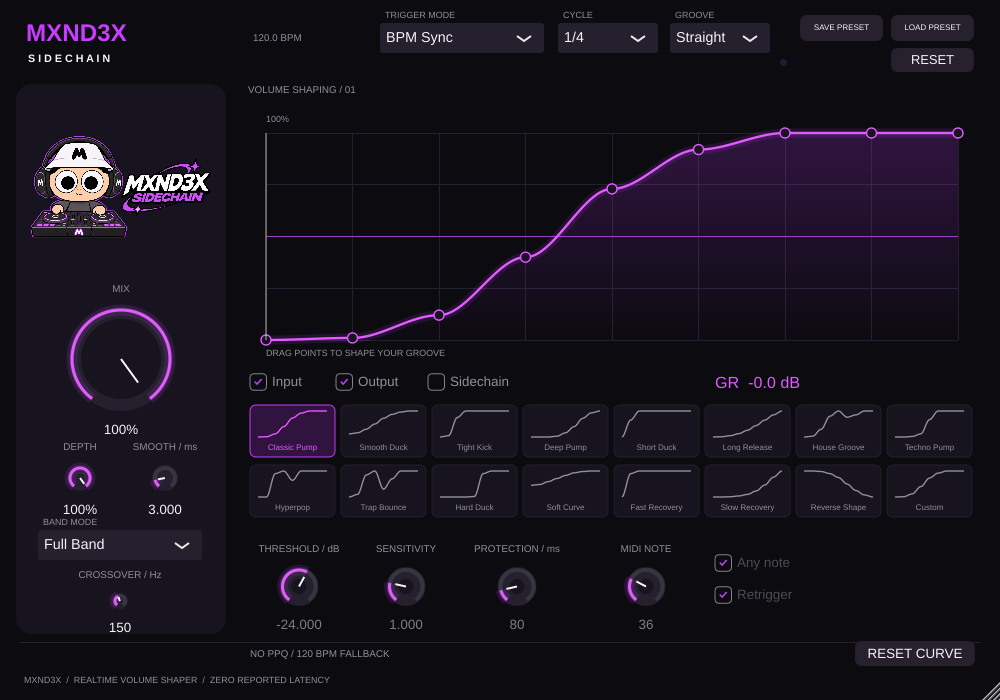

# MXND3X SIDECHAIN

JUCE 8.0.6 / C++17, VST3 volume shaper для mono/stereo. Собственная DSP-реализация, без кода, рисунков и пресетов Kickstart.



## Возможности

- 16 разных форм, 9 перетаскиваемых точек, плавная smoothstep-интерполяция, Reset Curve.
- SYNC от BPM/PPQ хоста, сетки 1/1–1/32, straight/triplet/dotted. При остановке транспорт отпускает подавление; перемещения и loop рассчитываются из новой PPQ-позиции.
- Mix, Depth, Smooth 0–20 ms. При 0 ms остаётся защитное сглаживание 0.25 ms. Mix/Depth 0% после окончания автоматизации дают точный исходный сигнал.
- Full/Low/High Band, LR4 crossover 40–1000 Hz (150 Hz по умолчанию), сглаживание параметров и переключений.
- Audio Trigger от отдельного VST3 sidechain bus: порог, чувствительность, гистерезис, защита от повторов.
- MIDI Trigger: Note On с sample offsets, любая/выбранная нота, повторный запуск или ожидание завершения цикла.
- Состояние всех параметров и точек через APVTS; файловые `.mxpreset` через Save/Load.
- Реальные Input/Output/Sidechain waveforms через SPSC очередь; измерение GR из энергий входа/выхода. Без внешнего bus кик не рисуется.
- Масштабируемое тёмное фиолетовое окно 1000×700; подсветка ручек, миниатюры кривых, движущаяся позиция.

## Windows 10/11 x64: сборка

Установите Git, CMake ≥3.22 и Visual Studio 2022 с **Desktop development with C++**, MSVC x64 и Windows SDK. Из PowerShell:

```powershell
./scripts/build-windows.ps1
# либо с готовым исходным checkout JUCE 8.0.6:
./scripts/build-windows.ps1 -JuceDir C:\SDK\JUCE
```

Скрипт использует генератор Visual Studio 17 2022, архитектуру x64, Release и запускает тесты. JUCE по умолчанию загружается по закреплённому commit. VST3 SDK берётся из JUCE; отдельная загрузка SDK не нужна.

Результат: `dist/MXND3X SIDECHAIN.vst3` — это целый bundle-каталог. Внутри Windows-сборки должен находиться `Contents/x86_64-win/MXND3X SIDECHAIN.vst3`. Нельзя заменить Windows-бинарник Linux-файлом `.so`.

Workflow `.github/workflows/windows.yml` также собирает, тестирует и сохраняет Windows bundle как artifact. Само наличие workflow не означает, что он уже выполнялся.

## Установка в FL Studio

1. Закройте DAW. Скопируйте весь каталог `MXND3X SIDECHAIN.vst3` в `C:\Program Files\Common Files\VST3\` (может понадобиться доступ администратора).
2. Откройте FL Studio → Options → Manage plugins → Find installed plugins.
3. Добавьте MXND3X SIDECHAIN в FX slot нужного Mixer insert.
4. Включите воспроизведение, оставьте BPM Sync, Mix 100%, Depth 100%, Cycle 1/4. Выберите форму, настройте Depth/Mix.
5. Для обработки баса выберите Low Band и начните с Crossover 150 Hz. Для тонкой настройки перетащите точки графика; статус станет Custom.

SYNC не требует кика на отдельном входе. Если хост не предоставляет PPQ, отображается предупреждение: используется свободный ход от аудиосэмплов (120 BPM либо известный BPM), без гарантии привязки к Playlist.

### Audio Trigger

С канала кика направьте сигнал в sidechain канала с плагином (в Mixer FL Studio — Sidechain to this track). В настройках wrapper Processing назначьте sidechain input плагина на этот вход, если ваша версия FL Studio предоставляет соответствующий VST3 bus. Выберите Audio Trigger, настройте Threshold, Sensitivity и Protection. Начальная нота кика должна пересекать порог; гистерезис требует спад ниже половины порога до следующего запуска. Включённый bus отображается как enabled, что само по себе не доказывает наличие сигнала: смотрите слой Sidechain. При недоступном bus интерфейс пишет NO EXTERNAL SIDECHAIN; используйте BPM Sync. Точный путь настройки зависит от версии FL Studio и требует проверки на Windows.

### MIDI Trigger

Выберите MIDI Trigger. В wrapper плагина назначьте MIDI input port, отправьте туда MIDI Out с тем же port. Оставьте Any note или задайте номер ноты (по умолчанию 36). Retrigger включает перезапуск активной огибающей; выключенный Retrigger ждёт завершения. Входящие MIDI-события потребляются эффектом. Маршрутизация MIDI в FX должна быть проверена в вашей версии FL Studio.

### Пресеты

Save Preset сохраняет параметры и пользовательскую кривую в `.mxpreset`. Load Preset восстанавливает их. Reset возвращает все параметры к исходным. Reset Curve возвращает только текущую фабричную форму. Все настройки автоматически входят в состояние проекта DAW.

## Сборка и тесты на Linux

На обычной Debian/Ubuntu машине установите CMake, компилятор C++17, pkg-config, libasound2-dev, libfreetype-dev, libfontconfig-dev, libx11-dev, libxext-dev, libxinerama-dev, libxrandr-dev, libxcursor-dev, libxrender-dev и xvfb.

```bash
cmake -S . -B build -DCMAKE_BUILD_TYPE=Release
cmake --build build --parallel 4
xvfb-run -a ctest --test-dir build --output-on-failure
```

Для DSP без JUCE и графических зависимостей:

```bash
cmake -S . -B build-dsp -DMXND3X_DSP_ONLY=ON -DCMAKE_BUILD_TYPE=Release
cmake --build build-dsp --parallel 4
ctest --test-dir build-dsp --output-on-failure
```

`ui_capture` создаёт реальный скриншот редактора `interface.png` в текущем каталоге; нужен DISPLAY или Xvfb. `pluginval --strictness-level 5 --validate <путь к bundle>` проверяет VST3.

## DSP и ограничения

Четвёртый порядок Linkwitz–Riley даёт фазово согласованную сумму wet-полос с all-pass фазой. Mix/Depth интерполируют исходный сигнал и обработанную сумму; частичное смешивание может менять частотный отклик около crossover из-за различия фаз, характерного для параллельной обработки IIR. Нулевая задержка означает 0 reported samples; это не линейно-фазовый кроссовер. Smooth меняет фактическое восстановление, а GR показывает энергетическое отношение, поэтому не обязан равняться значению кривой в текущем пикселе.

Обновление параметров хостом считывается в начале блока; MIDI и музыкальная фаза обрабатываются по сэмплам. Это не обещание sample-accurate VST3 parameter automation внутри блока. В аудиопотоке нет файловых операций, mutex и динамических контейнеров; waveform очередь при переполнении пропускает кадры.

Оригинальный PNG персонажа и логотипа находится в `Source/Assets/MXND3XCharacter.png` и обязателен для сборки. JUCE BinaryData упаковывает его внутрь плагина: отдельный файл картинки при установке не требуется. Рисунок встроен целиком, без перерисовки и изменения пропорций. Актуальный скриншот — `interface.png`.

Сведения о фактически выполненных проверках и артефактах — в `VALIDATION.md`. Проверка FL Studio и установка на реальном Windows-хосте не выполнялись в Linux-среде. До этих проверок это разработческая версия, а не подтверждённый production release.

## Лицензии

JUCE 8 доступен на условиях AGPLv3 либо коммерческой лицензии JUCE. Для распространения выберите подходящий вариант и соблюдите его требования; этот репозиторий не предоставляет коммерческую лицензию JUCE. Авторские права на персонажа остаются у владельца. Исходный код проекта предоставлен для разработки; отдельная лицензия на распространение проекта ещё не выбрана владельцем.
